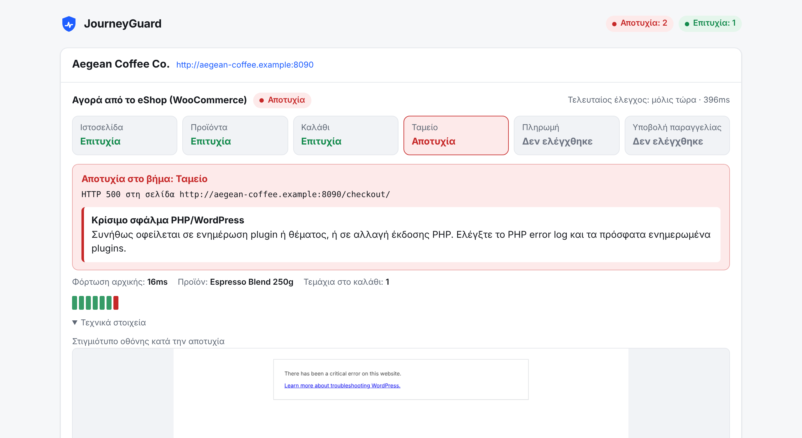
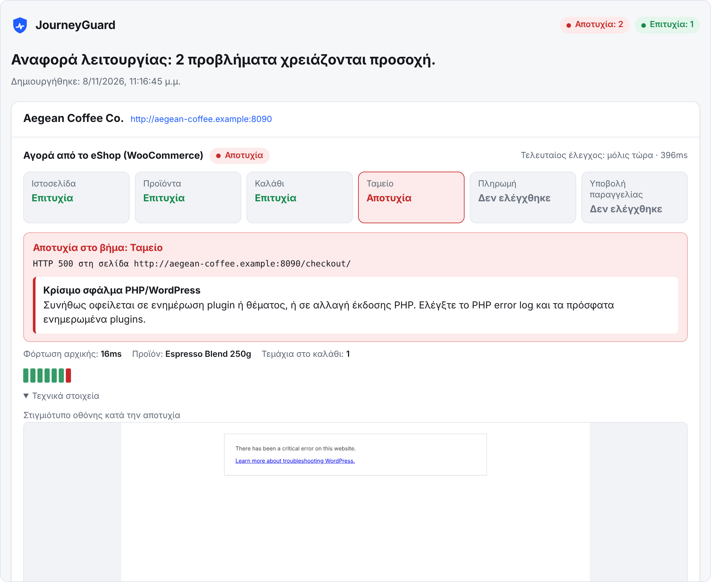
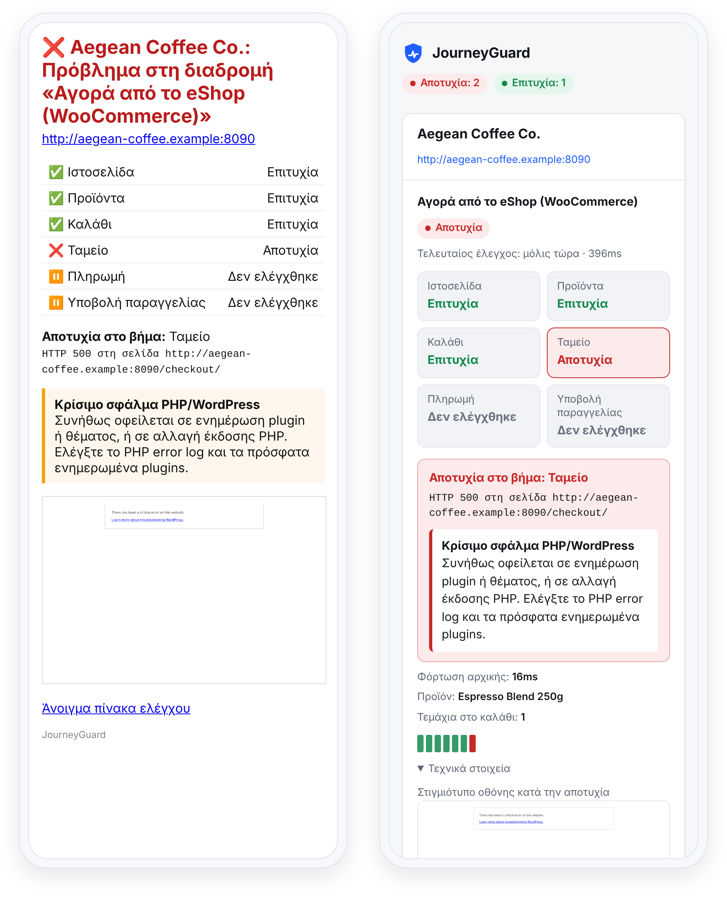

<div align="center">


# JourneyGuard

**Η ιστοσελίδα σας μπορεί να «λειτουργεί», ενώ οι πελάτες σας δεν μπορούν να αγοράσουν, να εγγραφούν ή να επικοινωνήσουν μαζί σας.**<br>
Το JourneyGuard περνά από το eShop και τις φόρμες σας όπως ένας πραγματικός πελάτης και σας λέει τι χάλασε και ποια είναι η πιθανή αιτία.

<p align="center">
  <picture>
    <source media="(max-width: 600px) and (prefers-color-scheme: dark)" srcset="docs/assets/hero-el-mobile-dark.svg">
    <source media="(max-width: 600px)" srcset="docs/assets/hero-el-mobile-light.svg">
    <source media="(prefers-color-scheme: dark)" srcset="docs/assets/hero-el-dark.svg">
    
  </picture>
</p>

[](https://github.com/nxdpro/journeyguard/actions/workflows/ci.yml)
[](https://github.com/nxdpro/journeyguard/releases)
[](LICENSE)
[](https://github.com/nxdpro/journeyguard/pkgs/container/journeyguard)

<sub>Δωρεάν · Ανοιχτού κώδικα (MIT) · Τρέχει στον δικό σας server</sub>

[Έλεγχος σε ένα λεπτό](#ελέγξτε-την-ιστοσελίδα-σας-με-μία-εντολή) · [Εγκατάσταση](#εγκατάσταση) · [Τεκμηρίωση](#τεκμηρίωση) · [Συχνές ερωτήσεις](#συχνές-ερωτήσεις) · [English](README.md)

</div>

## Ελέγξτε την ιστοσελίδα σας με μία εντολή

```bash
docker run --rm ghcr.io/nxdpro/journeyguard \
  check https://to-eshop-sas.gr --lang el
```

Χωρίς λογαριασμό και χωρίς αρχείο ρυθμίσεων. Το JourneyGuard αναγνωρίζει την πλατφόρμα και ελέγχει ό,τι ταιριάζει: την αρχική σελίδα και το SSL σε κάθε ιστοσελίδα, τη διαδρομή προϊόν → καλάθι → ταμείο → τρόποι πληρωμής σε WooCommerce και Shopify, και τη φόρμα της σελίδας επικοινωνίας, αν υπάρχει. Δεν αγοράζει τίποτα και δεν στέλνει μήνυμα: η φόρμα συμπληρώνεται, αλλά δεν υποβάλλεται. Με το `--lang el` τα αποτελέσματα εμφανίζονται στα ελληνικά για κάθε ιστοσελίδα, ακόμη και `.com`. Για `.gr` και `.cy` αυτό γίνεται αυτόματα.

<details>
<summary>Αποθηκεύστε μια αναφορά HTML με στιγμιότυπα οθόνης (screenshots)</summary>

```bash
docker run --rm --user "$(id -u):$(id -g)" -e HOME=/tmp -v "$PWD:/out" \
  ghcr.io/nxdpro/journeyguard check https://to-eshop-sas.gr \
  --lang el --report /out/report.html
```

Το `report.html` αποθηκεύεται στον τρέχοντα φάκελο: ένα αυτόνομο αρχείο που μπορείτε να στείλετε σε πελάτη.

</details>

Ελέγχετε μόνο ιστοσελίδες που σας ανήκουν ή έχετε άδεια να ελέγξετε.

**Προτιμάτε να το κάνουμε εμείς;** Στείλτε μας τη διεύθυνση του eShop σας στο [info@nxdpro.com](mailto:info@nxdpro.com?subject=%CE%94%CF%89%CF%81%CE%B5%CE%AC%CE%BD%20%CE%AD%CE%BB%CE%B5%CE%B3%CF%87%CE%BF%CF%82%20eShop) και το ελέγχουμε δωρεάν, ή στήνουμε το JourneyGuard και το παρακολουθούμε για εσάς.

> [!NOTE]
> **Κατάσταση: πρώτη έκδοση (v0.1.1).** 65 αυτόματα tests, ανάμεσά τους 14 προσομοιωμένες βλάβες και παγίδες για ψευδείς συναγερμούς στο δοκιμαστικό eShop, και έλεγχοι στις δικές μας ιστοσελίδες. Οι ψευδείς συναγερμοί είναι τα σφάλματα που μας απασχολούν περισσότερο: αν δείτε κάποιον, [πείτε μας](https://github.com/nxdpro/journeyguard/issues/new/choose).

## Γιατί δεν αρκεί ένα uptime monitor

Οι περισσότερες βλάβες που κοστίζουν χρήματα σε μια μικρή επιχείρηση δεν είναι «έπεσε ο server».

| Τι χαλάει | Uptime monitor | Journey&#8203;Guard |
|---|:---:|:---:|
| Ο server δεν απαντά | ✅ | ✅ |
| Μια ενημέρωση plugin «ρίχνει» το **ταμείο**, ενώ η αρχική ανοίγει κανονικά | – | ✅ |
| Η **προσθήκη στο καλάθι** σταματά να λειτουργεί μετά από αλλαγή θέματος | – | ✅ |
| Ένας κανόνας caching **αδειάζει το καλάθι** στον δρόμο προς το ταμείο | – | ✅ |
| Με ληγμένα κλειδιά του παρόχου χάνεται η **πληρωμή με κάρτα** και μένει μόνο η αντικαταβολή | – | ✅¹ |
| Η **φόρμα επικοινωνίας** γράφει «Σφάλμα κατά την αποστολή του μηνύματος» | – | ✅ |
| Στιγμιότυπο και πιθανή αιτία τη στιγμή της βλάβης | – | ✅ |
| Ελέγχει το ταμείο χωρίς να κάνει πραγματική παραγγελία | – | ✅ |

<sub>¹ Όταν ορίσετε με `expectPayments` τους τρόπους πληρωμής που πρέπει να υπάρχουν.</sub>

Στις γραμμές 2 έως 6, ένα uptime monitor που ελέγχει την αρχική εξακολουθεί να βλέπει `200 OK`. Το JourneyGuard ανοίγει πραγματικό browser και κάνει τη διαδρομή βήμα βήμα. Σε αντίθεση με το Checkly, το Datadog Synthetics ή δικά σας tests με Playwright, δεν χρειάζεται να γράψετε ή να συντηρείτε κώδικα για tests: τα έτοιμα σενάρια (presets) βρίσκουν προϊόν προς αγορά μέσω του WooCommerce Store API ή του `products.json` του Shopify, οπότε μια αλλαγή θέματος σπάνια τα επηρεάζει. Συμπληρώνει ένα uptime monitor όπως το [Uptime Kuma](https://github.com/louislam/uptime-kuma). Ρυθμίστε το να ελέγχει και το `/healthz` του JourneyGuard, ώστε να παρακολουθείται και το ίδιο.

## Δείτε το στην πράξη

```bash
docker run --rm -p 8080:8080 ghcr.io/nxdpro/journeyguard demo --host 0.0.0.0 --lang el
```

Ξεκινά ένα μικρό δοκιμαστικό eShop, το Aegean Coffee Co., το ελέγχει ενώ λειτουργεί κανονικά, «σπάει» το ταμείο του και σας δείχνει τον πίνακα ελέγχου στο http://localhost:8080: βήματα, ιστορικό και τεχνικά στοιχεία για κάθε διαδρομή, με κουμπί **Έλεγχος τώρα**. Προσθέστε `--break` με `add-to-cart`, `payment`, `cart-session`, `contact`, `down` ή `flaky-checkout` για να δοκιμάσετε άλλες βλάβες. Οι επτά παγίδες για ψευδείς συναγερμούς (`firewall`, `cookie-banner`, `free-order`, `redirect-to-cart`, `contact-spam`, `contact-invalid`, `contact-robot`) δείχνουν ότι αυτές οι περιπτώσεις δεν προκαλούν συναγερμό. Η εικόνα Docker είναι περίπου 900 MB.

<p align="center">
  <picture>
    <source media="(max-width: 600px)" srcset="docs/assets/demo-el-mobile.svg">
    
  </picture>
</p>

Η ίδια βλάβη στον πίνακα ελέγχου, με το στιγμιότυπο τη στιγμή της αποτυχίας:

<p align="center">
  <picture>
    <source media="(max-width: 600px) and (prefers-color-scheme: dark)" srcset="docs/assets/dashboard-mobile-dark-el.png">
    <source media="(max-width: 600px)" srcset="docs/assets/dashboard-mobile-el.png">
    <source media="(prefers-color-scheme: dark)" srcset="docs/assets/dashboard-dark-el.png">
    
  </picture>
</p>

<details>
<summary>Περισσότερα στιγμιότυπα: η αναφορά για τον πελάτη</summary>
<br>

<p align="center">
  
</p>

</details>

## Εγκατάσταση

Οποιοσδήποτε υπολογιστής με Docker που μένει συνεχώς ανοιχτός (amd64 ή arm64), π.χ. ένας μικρός VPS. 1 vCPU και 1–2 GB RAM αρκούν για δεκάδες διαδρομές. Δεν χρειάζεται βάση δεδομένων: τα αποτελέσματα αποθηκεύονται σε αρχεία JSON και PNG.

**1. Οδηγός ρύθμισης.** Λίγες ερωτήσεις, στα ελληνικά με το `--lang el`. Αναγνωρίζει την πλατφόρμα και επιλέγει τις διαδρομές που ταιριάζουν, ρυθμίζει τις ειδοποιήσεις (για το Telegram βρίσκει μόνο του τη συνομιλία σας και στέλνει δοκιμαστικό μήνυμα) και δημιουργεί το `journeyguard.yml` και ένα ιδιωτικό `.env` με αυτόματο κωδικό για τον πίνακα ελέγχου.

```bash
mkdir journeyguard && cd journeyguard
docker run --rm -it --user "$(id -u):$(id -g)" -v "$PWD:/config" \
  ghcr.io/nxdpro/journeyguard init --config /config/journeyguard.yml --lang el
```

**2. Εκκίνηση.**

```bash
curl -O https://raw.githubusercontent.com/nxdpro/journeyguard/main/docker-compose.yml
docker compose up -d
```

**3. Ανοίξτε τον πίνακα ελέγχου** στο `http://<διεύθυνση-του-server>:8080`, με οποιοδήποτε όνομα χρήστη και τον κωδικό που εμφάνισε ο οδηγός (υπάρχει και στο `.env`). Χρήσιμες εντολές:

```bash
# Δοκιμαστικό μήνυμα σε κάθε κανάλι ειδοποιήσεων
docker compose run --rm journeyguard test-alerts

# Κάθε έλεγχος μία φορά (στέλνει και το δοκιμαστικό μήνυμα της φόρμας)
docker compose run --rm journeyguard run
```

Αν αλλάξετε το `journeyguard.yml` ή το `.env`, εφαρμόστε την αλλαγή με `docker compose up -d --force-recreate`.

> [!IMPORTANT]
> **Σημαντικό:** αν ο πίνακας ελέγχου είναι προσβάσιμος από το internet, βάλτε τον πίσω από HTTPS ([παράδειγμα με Caddy](docs/deployment.md#docker-compose-recommended), στα αγγλικά). Αλλιώς ο κωδικός ταξιδεύει χωρίς κρυπτογράφηση.

<details>
<summary>Χωρίς Docker (Node.js 22+)</summary>

```bash
git clone https://github.com/nxdpro/journeyguard && cd journeyguard
npm ci && npm run build && npm install -g .
# Chromium και, σε Linux, οι βιβλιοθήκες του (ζητά sudo)
npx playwright install --with-deps chromium
journeyguard demo --lang el
```

Μετά `journeyguard init --lang el`, `journeyguard run` και `journeyguard start`.

</details>

<details>
<summary>Όλες οι εντολές</summary>

| Εντολή | Τι κάνει |
|---|---|
| <code>init&nbsp;[url]</code> | Οδηγός ρύθμισης: αναγνωρίζει την πλατφόρμα, ρυθμίζει τις ειδοποιήσεις, δημιουργεί τα `journeyguard.yml` και `.env` |
| `run` | Εκτελεί κάθε διαδρομή μία φορά, με κωδικό εξόδου 1 αν κάτι αποτύχει. Με `--due` εκτελεί μόνο όσες έχει έρθει η ώρα τους (για cron) |
| `start` | Εκτελεί τους ελέγχους με πρόγραμμα και κάνει διαθέσιμο τον πίνακα ελέγχου |
| `serve` | Κάνει διαθέσιμο μόνο τον πίνακα ελέγχου |
| <code>check&nbsp;&lt;url&gt;</code> | Ελέγχει μία φορά οποιαδήποτε ιστοσελίδα, χωρίς ρυθμίσεις |
| <code>detect&nbsp;&lt;url&gt;</code> | Δείχνει τι αναγνωρίζει το JourneyGuard σε μια ιστοσελίδα |
| `validate` | Ελέγχει το αρχείο ρυθμίσεων |
| `test-alerts` | Στέλνει δοκιμαστικό μήνυμα σε κάθε κανάλι ειδοποιήσεων |
| `demo` | Ξεκινά το ενσωματωμένο δοκιμαστικό eShop |

Όλες τις επιλογές τις εμφανίζει το `journeyguard --help` (στα αγγλικά). Το `--lang el` ισχύει για τα `check`, `demo` και `init`.

</details>

Reverse proxy, systemd, cron, αντίγραφα ασφαλείας και επίλυση προβλημάτων: [docs/deployment.md](docs/deployment.md) (στα αγγλικά). Αν θέλετε να [τρέχετε τις ίδιες διαδρομές στο CI μετά από κάθε deploy](docs/deployment.md#ci-smoke-test-every-deploy), ορίστε εκεί `submit: false` στις φόρμες επικοινωνίας, αλλιώς κάθε deploy θα στέλνει πραγματικό μήνυμα.

## Τι ελέγχει

| Preset | Τι ελέγχει |
|---|---|
| `website` | Η αρχική ανοίγει χωρίς σελίδα σφάλματος, φορτώνουν τα scripts και τα styles, ανοίγουν οι σελίδες που ορίζετε στο `pages`, το πιστοποιητικό SSL δεν λήγει σύντομα |
| `woocommerce` | Διαθέσιμο προϊόν → καλάθι → το προϊόν μένει στο καλάθι → ανοίγει το ταμείο → εμφανίζονται τρόποι πληρωμής, προαιρετικά αυτοί που ορίζετε (**χωρίς** να γίνει παραγγελία) |
| `shopify`&nbsp;(beta) | Το κατάστημα είναι ανοιχτό στο κοινό → προϊόν → καλάθι → ανοίγει το ταμείο → φορτώνει η ενότητα πληρωμής (**χωρίς** παραγγελία) |
| `contact-form` | Συμπληρώνει τη φόρμα όπως ένας επισκέπτης, την υποβάλλει μία φορά την ημέρα και περιμένει την επιβεβαίωση της ιστοσελίδας. Contact Form 7, WPForms, Gravity Forms, Elementor Forms, Fluent Forms, Ninja Forms, Divi και γενικές φόρμες. Με `submit: false` την ελέγχει χωρίς να τη στείλει |

Τα presets βρίσκουν μόνα τους προϊόντα, καλάθι, ταμείο και πεδία φόρμας, οπότε οι περισσότερες ιστοσελίδες δεν χρειάζονται selectors. Κλείνουν τα cookie banners όπως ένας επισκέπτης, επιλέγοντας πάντα «Μόνο τα απαραίτητα». CAPTCHA, γνωστά firewall και απορρίψεις από anti-spam εμφανίζονται ως «Δεν ελέγχθηκε», με οδηγία για το τι να ρυθμίσετε, ποτέ ως βλάβη.

Στο WooCommerce αναγνωρίζουν τους Έλληνες και Κύπριους παρόχους πληρωμών (Viva, JCC, Everypay, Cardlink, Nexi / Alpha Bank, Piraeus Bank, Eurobank / Worldline, IRIS), καθώς και Stripe, PayPal, Revolut και Klarna. Ορίστε με το `expectPayments` τους τρόπους πληρωμής που πρέπει να παραμένουν διαθέσιμοι, π.χ. `[Viva, Αντικαταβολή]`: η σύγκριση αγνοεί κεφαλαία και τόνους. Οτιδήποτε άλλο, όπως σύνδεση πελάτη, κρατήσεις ή εγγραφή σε newsletter, περιγράφεται με λίγες γραμμές YAML, χωρίς κώδικα.

<details>
<summary>Παράδειγμα <code>journeyguard.yml</code></summary>

```yaml
settings:
  language: el          # en | el | es: πίνακας ελέγχου, αναφορές και ειδοποιήσεις

alerts:
  - type: telegram
    botToken: ${TELEGRAM_BOT_TOKEN}
    chatId: ${TELEGRAM_CHAT_ID}

sites:
  - name: Το eShop μου
    url: https://to-eshop-sas.gr
    journeys:
      - preset: website
      - preset: woocommerce
        options:
          expectPayments: [Viva, Αντικαταβολή]   # ειδοποίηση αν χαθεί κάποιο από τα δύο
      - preset: contact-form
        options: { path: /epikoinonia/ }
      - name: Εγγραφή στο newsletter      # δική σας διαδρομή, χωρίς κώδικα
        steps:
          - goto: /
          - fill: { selector: '#newsletter-email', value: 'monitor@example.com' }
          - click: { text: Εγγραφή }
          - expectText: Ευχαριστούμε για την εγγραφή
```

Ελέγξτε το με `journeyguard validate`.

</details>

Όλες οι επιλογές: [docs/presets.md](docs/presets.md). Ρυθμίσεις, βήματα και selectors: [docs/configuration.md](docs/configuration.md). Έτοιμες ρυθμίσεις: [examples/](examples). Όλα στα αγγλικά.

## Όταν κάτι χαλάσει

- **Ειδοποίηση** σε Telegram, Discord, Slack, email ή οποιοδήποτε webhook, μόνο όταν μια διαδρομή χαλάσει και όταν διορθωθεί (με τη διάρκεια της βλάβης). Telegram, Discord και email περιλαμβάνουν το στιγμιότυπο. Μια ειδοποίηση που δεν έγινε δεκτή από κανένα κανάλι στέλνεται ξανά στον επόμενο έλεγχο.
- **Το ακριβές βήμα** που απέτυχε, τα βήματα που δεν εκτελέστηκαν και **τεχνικά στοιχεία**: στιγμιότυπο, διεύθυνση και κωδικός HTTP της σελίδας, σφάλματα του browser, αποτυχημένα αιτήματα δικτύου.
- **Πιθανή αιτία** με απλά λόγια, στα ελληνικά, αγγλικά ή ισπανικά, π.χ. *«Οι πελάτες χάνουν το καλάθι τους στο ταμείο: πιθανότατα γίνεται caching στις σελίδες καλαθιού και ταμείου.»*
- **Αυτόνομη αναφορά HTML** για τον πελάτη (`--report report.html`), με το δικό σας brand.
- **Παρακολουθεί και τον εαυτό του**: μία ειδοποίηση αν το JourneyGuard δεν μπορεί να εκτελέσει τους ελέγχους (και το `/healthz` απαντά 503), και μία αν ένα firewall ή CAPTCHA κρατά μια διαδρομή στο «Δεν ελέγχθηκε» για μία ημέρα (ή για τρεις κύκλους ελέγχου, αν η διαδρομή ελέγχεται πιο αραιά).

Κανάλια, χρονισμός και το payload του webhook: [docs/alerts.md](docs/alerts.md) (στα αγγλικά). Στο κινητό, η ειδοποίηση email και ο πίνακας ελέγχου φαίνονται έτσι:

<p align="center">
  <picture>
    <source media="(prefers-color-scheme: dark)" srcset="docs/assets/phones-dark-el.png">
    
  </picture>
</p>

## Ασφάλεια

- **Η ασφαλής λειτουργία είναι ενεργή από προεπιλογή.** Το JourneyGuard αρνείται να πατήσει κουμπιά όπως «Ολοκλήρωση παραγγελίας», «Πληρωμή τώρα» ή *Place order*, με κεφαλαία ή πεζά, με ή χωρίς τόνους. Ένας μηχανισμός μέσα στη σελίδα μπλοκάρει επίσης το Enter στα πεδία του ταμείου και τα scripts που υποβάλλουν τη φόρμα παραγγελίας, ενώ τα αιτήματα παραγγελίας και πληρωμής μπλοκάρονται στο δίκτυο (WooCommerce, Shopify, OpenCart, PrestaShop, Magento, Stripe, PayPal). Τα presets καταστημάτων σταματούν μόλις φορτώσει το βήμα της πληρωμής.
- **Δηλώνει την ταυτότητά του.** Κάθε αίτημα έχει `JourneyGuard/<version>` στο user agent και τα αιτήματα προς την ιστοσελίδα σας έχουν το header `X-JourneyGuard: 1`, ώστε να το αναγνωρίζετε στα logs και να το εξαιρείτε από τα analytics. Για να περνά από το firewall, επιτρέψτε τη διεύθυνση IP του server ή ένα δικό σας μυστικό header ([οδηγίες](docs/firewalls.md), στα αγγλικά). Τα επιπλέον headers δεν στέλνονται ποτέ σε τρίτους.
- **Δεν παρακάμπτει CAPTCHA ή προστασία από bots.** Μια σελίδα που ζητά επαλήθευση εμφανίζεται ως «Δεν ελέγχθηκε» και δεν γίνεται καμία απόπειρα παράκαμψης.

> [!IMPORTANT]
> **Σημαντικό:** παρακολουθείτε μόνο ιστοσελίδες που σας ανήκουν ή έχετε εξουσιοδότηση να ελέγξετε. Διαβάστε το [docs/safety.md](docs/safety.md) (στα αγγλικά).

## Γνωστοί περιορισμοί

- **Η παράδοση των email δεν επαληθεύεται ακόμη.** Ο έλεγχος της φόρμας επιβεβαιώνει ότι η ιστοσελίδα δείχνει «στάλθηκε». Ο έλεγχος των εισερχομένων (IMAP) έρχεται στην έκδοση 0.2.
- **CAPTCHA και γνωστοί έλεγχοι για bots** (Cloudflare, Sucuri, Wordfence, Imunify360, όρια αιτημάτων) εμφανίζονται ως «Δεν ελέγχθηκε» μέχρι να επιτρέψετε την πρόσβαση στο JourneyGuard. Ένα σκέτο «403 Forbidden» από firewall που το JourneyGuard δεν αναγνωρίζει μετρά ως αποτυχία, γιατί μπορεί να απορρίπτονται και πραγματικοί επισκέπτες.
- **Ελέγχεται ότι εμφανίζονται οι τρόποι πληρωμής, όχι ότι η πληρωμή ολοκληρώνεται.** Χωρίς `expectPayments` ο έλεγχος αποτυγχάνει μόνο αν δεν εμφανίζεται κανένας τρόπος πληρωμής.
- **Το ταμείο του Shopify αλλάζει συχνά**, γι' αυτό το preset `shopify` είναι σε beta.

## Για agencies

- Όλες οι ιστοσελίδες των πελατών σας σε έναν πίνακα ελέγχου, η καθεμία με τις δικές της διαδρομές και το δικό της πρόγραμμα ([examples/agency.yml](examples/agency.yml)).
- Αναφορά HTML και πίνακας ελέγχου με το δικό σας brand (white-label): `report.brandName`, `report.brandUrl` και `report.poweredBy: false` στο `settings`.
- Ελληνικά, αγγλικά ή ισπανικά ανά εγκατάσταση: μία γλώσσα για ειδοποιήσεις, αναφορές και πίνακα ελέγχου.
- Δωρεάν έλεγχος για υποψήφιους πελάτες με `check --report`, με την άδειά τους ([οδηγίες](docs/deployment.md#one-off-checks-and-reports), στα αγγλικά).
- Σήμερα κάθε ειδοποίηση πηγαίνει σε όλα τα κανάλια. Ειδοποιήσεις ανά πελάτη έρχονται στην έκδοση 0.2.

Θέλετε να προσφέρετε παρακολούθηση με το δικό σας brand, χωρίς να διαχειρίζεστε servers; Ρωτήστε μας για το [Πρόγραμμα Μεταπωλητών & Συνεργατών](mailto:info@nxdpro.com?subject=JourneyGuard%20for%20agencies).

## Τεκμηρίωση

Οι οδηγοί είναι στα αγγλικά.

| Οδηγός | Τι περιέχει |
|---|---|
| [Presets](docs/presets.md) | Κάθε στάδιο και επιλογή των `website`, `woocommerce`, `shopify` και `contact-form` |
| [Ρυθμίσεις](docs/configuration.md) | Γενικές ρυθμίσεις, ιστοσελίδες, δικές σας διαδρομές, βήματα, selectors, κωδικοί εξόδου |
| [Ειδοποιήσεις](docs/alerts.md) | Telegram, Discord, Slack, email, το payload του webhook, πότε στέλνονται |
| [Εγκατάσταση σε server](docs/deployment.md) | Docker Compose, HTTPS, systemd, cron, CI, αντίγραφα ασφαλείας, επίλυση προβλημάτων |
| [Firewalls](docs/firewalls.md) | Πώς επιτρέπετε στο JourneyGuard να περνά από Cloudflare, Wordfence, Sucuri και Imunify360 |
| [Ασφάλεια](docs/safety.md) | Ασφαλής λειτουργία, παρενέργειες, analytics, τα δεδομένα σας |
| [Αλλαγές](CHANGELOG.md) · [Παραδείγματα](examples) | Τι άλλαξε σε κάθε έκδοση και έτοιμες ρυθμίσεις |

## Συχνές ερωτήσεις

<details>
<summary><b>Θα κάνει παραγγελίες ή θα στείλει μηνύματα;</b></summary>
<br>

Παραγγελίες και πληρωμές όχι: τα presets σταματούν μόλις φορτώσει το βήμα της πληρωμής, και η ασφαλής λειτουργία μπλοκάρει κουμπιά και αιτήματα παραγγελίας και στις δικές σας διαδρομές. Μια φόρμα επικοινωνίας που παρακολουθείται στέλνει ένα πραγματικό δοκιμαστικό μήνυμα την ημέρα, ώστε να βλέπετε ότι τα μηνύματα φτάνουν. Το `check` και το `submit: false` δεν στέλνουν ποτέ.

</details>

<details>
<summary><b>Η ιστοσελίδα μου έχει Cloudflare, Wordfence ή άλλο firewall.</b></summary>
<br>

Μια διαδρομή που σταματά σε έλεγχο ασφαλείας εμφανίζεται ως «Δεν ελέγχθηκε», με οδηγία. Επιτρέψτε τη διεύθυνση IP του server ή ένα μυστικό header που ορίζετε για την ιστοσελίδα ([βήμα βήμα](docs/firewalls.md), στα αγγλικά). Μην επιτρέψετε μόνο του το δημόσιο header `X-JourneyGuard`: μπορεί να το στείλει οποιοσδήποτε.

</details>

<details>
<summary><b>Θα επηρεάσει τα analytics μου;</b></summary>
<br>

Στο Google Tag Manager, προσθέστε στο trigger μια εξαίρεση για επισκέψεις με user agent που περιέχει `JourneyGuard`. Σε analytics στον server ή σε logs του CDN μπορείτε να φιλτράρετε και με το header `X-JourneyGuard`. Στα cookie banners απαντά πάντα «Μόνο τα απαραίτητα», οπότε όποιο tracking σέβεται τη συγκατάθεση δεν εκτελείται.

</details>

<details>
<summary><b>Πού πηγαίνουν τα δεδομένα μου; (GDPR)</b></summary>
<br>

Το JourneyGuard τρέχει στον δικό σας server, αποθηκεύει στιγμιότυπα των δικών σας σελίδων και δεν στέλνει δεδομένα πουθενά, εκτός από τα κανάλια ειδοποιήσεων που ορίζετε.

</details>

<details>
<summary><b>Τι χρειάζομαι για να το τρέξω;</b></summary>
<br>

Για έναν μεμονωμένο έλεγχο, οποιονδήποτε υπολογιστή με Docker. Για παρακολούθηση, ένα container που τρέχει συνεχώς (amd64 ή arm64): 1 vCPU και 1–2 GB RAM αρκούν για δεκάδες διαδρομές, γιατί οι διαδρομές εκτελούνται μία μία. Ένα GitHub Action που εκτελεί ελέγχους χωρίς server έρχεται στην έκδοση 0.2. Μπορούμε επίσης να [το τρέχουμε εμείς για εσάς](#επαγγελματική-υποστήριξη).

</details>

<details>
<summary><b>Ποιες πλατφόρμες υποστηρίζει;</b></summary>
<br>

WooCommerce, Shopify (beta) και κάθε ιστοσελίδα ή φόρμα επικοινωνίας. Presets για PrestaShop και OpenCart έρχονται στην έκδοση 0.2 (για το Magento το συζητάμε). Μέχρι τότε, περιγράψτε τη διαδρομή σε YAML.

</details>

## Επόμενες εκδόσεις και συνεισφορά

- **v0.2, αξιόπιστα αποτελέσματα:** επαλήθευση παράδοσης για τις φόρμες (IMAP), presets για PrestaShop και OpenCart, ειδοποιήσεις ανά ιστοσελίδα, υπενθυμίσεις για βλάβες που διαρκούν, παράθυρα συντήρησης.
- **v0.3, καλύτερες εξηγήσεις:** προαιρετική διάγνωση με AI και δικό σας κλειδί, εντοπισμός οπτικών αλλαγών, όρια στον χρόνο φόρτωσης, εργαλείο καταγραφής διαδρομών.
- **v0.4, ομάδες και agencies:** πίνακας ελέγχου για πολλούς χρήστες, δημόσια σελίδα κατάστασης, χώροι εργασίας για agencies.

Η πλήρης λίστα και η ψηφοφορία είναι στο [ROADMAP.md](ROADMAP.md) (στα αγγλικά), όπου μπορείτε να ζητήσετε και νέες πλατφόρμες. Αναφορές για σφάλματα και ψευδείς συναγερμούς, presets για νέες πλατφόρμες, κανόνες διάγνωσης, μεταφράσεις και τεκμηρίωση είναι ευπρόσδεκτα: ξεκινήστε από το [CONTRIBUTING.md](CONTRIBUTING.md) (στα αγγλικά). Το `npm test` κάνει build και εκτελεί τα 65 tests. Όσα είναι end-to-end τρέχουν στο δοκιμαστικό eShop. Το preset `shopify` δεν έχει ακόμη end-to-end test, και κάθε βοήθεια είναι ευπρόσδεκτη.

## Επαγγελματική υποστήριξη

Το JourneyGuard αναπτύσσεται και συντηρείται από την [NXDPRO Solutions](https://www.nxdpro.com/?utm_source=github&utm_medium=readme-el&utm_campaign=journeyguard), εταιρεία στη Λεμεσό που από το 2003 φτιάχνει ιστοσελίδες, eShop και εξειδικευμένα συστήματα για επιχειρήσεις σε Κύπρο και Ελλάδα.

**Δεν θέλετε να ασχοληθείτε με server;** Ελέγχουμε δωρεάν το eShop σας ή στήνουμε το JourneyGuard και το παρακολουθούμε για εσάς. Αν βρει πρόβλημα που δεν θέλετε να διορθώσετε μόνοι σας, μπορούμε να βοηθήσουμε και σε αυτό: [info@nxdpro.com](mailto:info@nxdpro.com?subject=%CE%94%CF%89%CF%81%CE%B5%CE%AC%CE%BD%20%CE%AD%CE%BB%CE%B5%CE%B3%CF%87%CE%BF%CF%82%20eShop).

## Άδεια

[MIT](LICENSE) © NXDPRO Solutions
