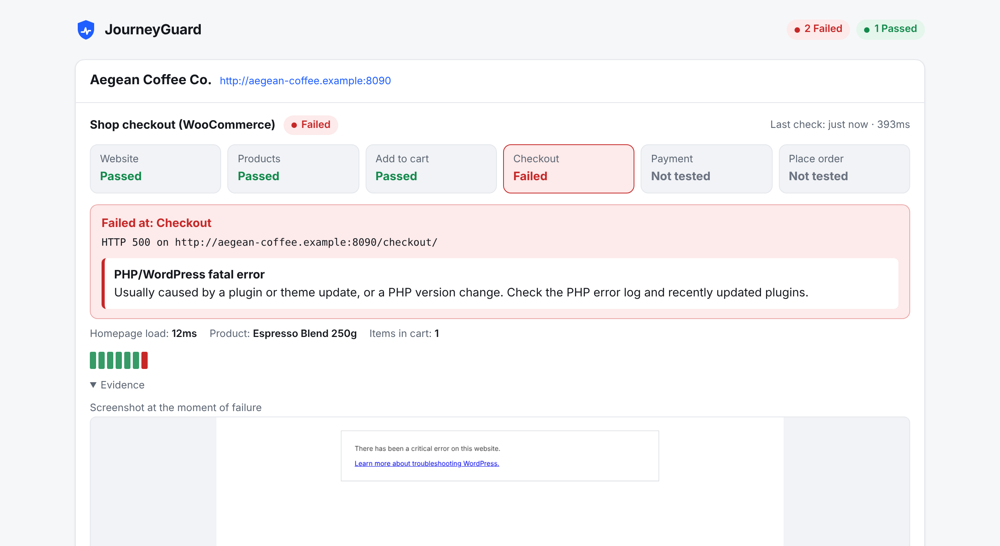
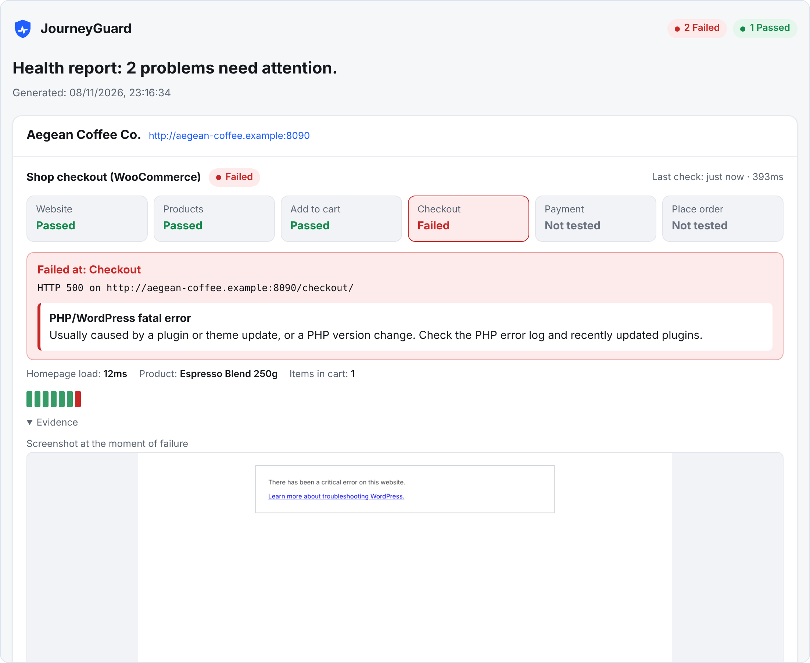
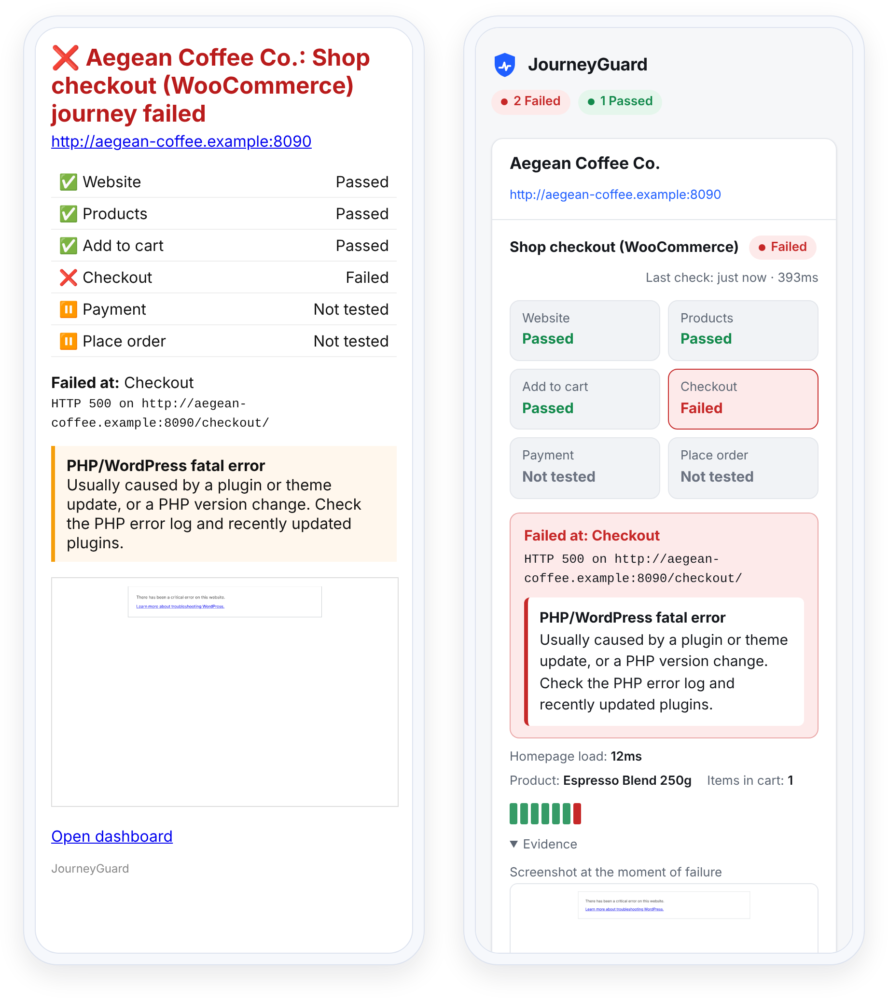

<div align="center">


# JourneyGuard

**Your website can be “up” while customers can’t buy, sign up or contact you.**<br>
JourneyGuard walks through your shop and forms like a real customer and tells you what broke, and the likely cause.

<p align="center">
  <picture>
    <source media="(max-width: 600px) and (prefers-color-scheme: dark)" srcset="docs/assets/hero-mobile-dark.svg">
    <source media="(max-width: 600px)" srcset="docs/assets/hero-mobile-light.svg">
    <source media="(prefers-color-scheme: dark)" srcset="docs/assets/hero-dark.svg">
    
  </picture>
</p>

[](https://github.com/nxdpro/journeyguard/actions/workflows/ci.yml)
[](https://github.com/nxdpro/journeyguard/releases)
[](LICENSE)
[](https://github.com/nxdpro/journeyguard/pkgs/container/journeyguard)

<sub>Free · Open source (MIT) · Runs on your own server</sub>

[Check your site](#check-your-site-in-one-minute) · [Quick start](#quick-start) · [Documentation](#documentation) · [FAQ](#faq) · [Ελληνικά](README.el.md)

</div>

## Check your site in one minute

```bash
docker run --rm ghcr.io/nxdpro/journeyguard \
  check https://your-shop.com
```

No account and no config file. JourneyGuard detects the platform and walks the journeys that fit: homepage and SSL on any site; product → cart → checkout → payment methods on WooCommerce and Shopify; and the contact form, if the contact page has one. Nothing is bought and no message is sent: the form is filled in but not submitted. Results are in Greek for `.gr` and `.cy` sites; choose with `--lang en|el|es`.

<details>
<summary>Save an HTML report with screenshots</summary>

```bash
docker run --rm --user "$(id -u):$(id -g)" -e HOME=/tmp -v "$PWD:/out" \
  ghcr.io/nxdpro/journeyguard check https://your-shop.com --report /out/report.html
```

`report.html` is saved in the current folder: a self-contained file you can send to a client.

</details>

Only check sites you own or are allowed to test.

> [!NOTE]
> **Early release (v0.1.1).** 65 automated tests, including 14 simulated breakages and false-alarm traps on the bundled demo shop, plus checks on our own production sites. False alarms are the bugs we care about most: please [report them](https://github.com/nxdpro/journeyguard/issues/new/choose).

## Why uptime is not enough

Most outages that cost small businesses money are not "the server is down".

| What goes wrong | Uptime monitor | Journey&#8203;Guard |
|---|:---:|:---:|
| The server is down | ✅ | ✅ |
| A plugin update crashes **checkout**; the homepage still loads | – | ✅ |
| **Add to cart** stops working after a theme change | – | ✅ |
| A caching rule **empties the cart** on the way to checkout | – | ✅ |
| Expired gateway keys remove the **card payment**; only cash on delivery is left | – | ✅¹ |
| The **contact form** says "error sending your message" | – | ✅ |
| Screenshot and likely cause at the moment of failure | – | ✅ |
| Checks checkout without placing a real order | – | ✅ |

<sub>¹ When you name the methods that must stay on offer with `expectPayments`.</sub>

In rows two to six, an uptime monitor that watches the homepage still sees `200 OK`. JourneyGuard opens a real browser and goes through the journey step by step. Unlike Checkly, Datadog Synthetics or your own Playwright tests, there is no test code to write or maintain: presets find a buyable product through the WooCommerce Store API or Shopify's `products.json`, so little breaks when the theme changes. It complements an uptime monitor such as [Uptime Kuma](https://github.com/louislam/uptime-kuma): point the uptime monitor at JourneyGuard's `/healthz` to watch JourneyGuard too.

## See it in action

```bash
docker run --rm -p 8080:8080 ghcr.io/nxdpro/journeyguard demo --host 0.0.0.0
```

It starts a small demo shop, Aegean Coffee Co., checks it while it is healthy, breaks its checkout, and serves the dashboard on http://localhost:8080: steps, history and evidence for each journey, with a **Run now** button. Add `--break` with `add-to-cart`, `payment`, `cart-session`, `contact`, `down` or `flaky-checkout` to try other failures. The seven false-alarm traps (`firewall`, `cookie-banner`, `free-order`, `redirect-to-cart`, `contact-spam`, `contact-invalid`, `contact-robot`) show that those cases raise no alarm. The image is about 900 MB.

<p align="center">
  <picture>
    <source media="(max-width: 600px)" srcset="docs/assets/demo-mobile.svg">
    
  </picture>
</p>

The same failure on the dashboard, with the screenshot taken at the moment of failure:

<p align="center">
  <picture>
    <source media="(max-width: 600px) and (prefers-color-scheme: dark)" srcset="docs/assets/dashboard-mobile-dark.png">
    <source media="(max-width: 600px)" srcset="docs/assets/dashboard-mobile.png">
    <source media="(prefers-color-scheme: dark)" srcset="docs/assets/dashboard-dark.png">
    
  </picture>
</p>

<details>
<summary>More screenshots: the client report</summary>
<br>

<p align="center">
  
</p>

</details>

## Quick start

Any always-on machine with Docker (amd64 or arm64). 1 vCPU and 1–2 GB RAM check dozens of journeys. No database: results are JSON and PNG files.

**1. Guided setup.** A few questions in English, Greek or Spanish. It detects your platform and picks the journeys that fit, sets up alerts (for Telegram it finds your chat by itself and sends a test message), and writes `journeyguard.yml` and a private `.env` with a generated dashboard password.

```bash
mkdir journeyguard && cd journeyguard
docker run --rm -it --user "$(id -u):$(id -g)" -v "$PWD:/config" \
  ghcr.io/nxdpro/journeyguard init --config /config/journeyguard.yml
```

**2. Start it.**

```bash
curl -O https://raw.githubusercontent.com/nxdpro/journeyguard/main/docker-compose.yml
docker compose up -d
```

**3. Open the dashboard** at `http://your-server:8080`: any username, plus the password the setup printed (it is also in `.env`). Useful one-off commands:

```bash
# Send a test message to every alert channel
docker compose run --rm journeyguard test-alerts

# Run every check once (also sends the contact-form test message)
docker compose run --rm journeyguard run
```

After editing `journeyguard.yml` or `.env`, apply the change with `docker compose up -d --force-recreate`.

> [!IMPORTANT]
> If the dashboard is reachable from the internet, put it behind HTTPS ([Caddy example](docs/deployment.md#docker-compose-recommended)). Otherwise the password travels in clear text.

<details>
<summary>Without Docker (Node.js 22+)</summary>

```bash
git clone https://github.com/nxdpro/journeyguard && cd journeyguard
npm ci && npm run build && npm install -g .
# Chromium plus, on Linux, its system libraries (asks for sudo)
npx playwright install --with-deps chromium
journeyguard demo
```

Then `journeyguard init`, `journeyguard run` and `journeyguard start`.

</details>

<details>
<summary>All commands</summary>

| Command | What it does |
|---|---|
| <code>init&nbsp;[url]</code> | Guided setup: detects the platform, sets up alerts, writes `journeyguard.yml` and `.env` |
| `run` | Runs every journey once; exit code 1 on failure. `--due` runs only journeys whose interval has passed (for cron) |
| `start` | Runs on a schedule and serves the dashboard |
| `serve` | Serves the dashboard only |
| <code>check&nbsp;&lt;url&gt;</code> | Checks any site once, no setup |
| <code>detect&nbsp;&lt;url&gt;</code> | Shows what JourneyGuard detects on a site |
| `validate` | Checks the configuration file |
| `test-alerts` | Sends a test message to every alert channel |
| `demo` | Starts the built-in demo shop |

`journeyguard --help` lists every option.

</details>

Reverse proxy, systemd, cron, backups and troubleshooting: [docs/deployment.md](docs/deployment.md). To [run the same journeys in CI after every deploy](docs/deployment.md#ci-smoke-test-every-deploy), set `submit: false` on contact forms there, or every deploy sends a real message.

## What it checks

| Preset | What it checks |
|---|---|
| `website` | Homepage loads without an error page, scripts and styles load, the pages you list in `pages` open, SSL certificate is not about to expire |
| `woocommerce` | In-stock product → add to cart → cart keeps it → checkout opens → payment methods are offered, optionally the ones you name (order **not** placed) |
| `shopify`&nbsp;(beta) | Store is public → product → add to cart → checkout opens → payment section loads (order **not** placed) |
| `contact-form` | Fills in the form like a visitor, sends it once a day and waits for the site's confirmation. Contact Form 7, WPForms, Gravity Forms, Elementor Forms, Fluent Forms, Ninja Forms, Divi and generic forms. `submit: false` checks it without sending |

Presets find products, cart, checkout and form fields on their own, so most sites need no selectors. They close cookie banners like a visitor, always choosing "necessary only", and report CAPTCHAs, recognised firewalls and anti-spam answers as *not tested* with a hint, never as outages.

On WooCommerce they recognise Greek and Cypriot payment providers (Viva, JCC, Everypay, Cardlink, Nexi / Alpha Bank, Piraeus Bank, Eurobank / Worldline, IRIS) as well as Stripe, PayPal, Revolut and Klarna. Name the ones that must stay on offer with `expectPayments`. Anything else, such as log-in, bookings or a newsletter, is a few lines of YAML with no code.

<details>
<summary>Example <code>journeyguard.yml</code></summary>

```yaml
settings:
  language: en          # en | el | es: dashboard, reports and alerts

alerts:
  - type: telegram
    botToken: ${TELEGRAM_BOT_TOKEN}
    chatId: ${TELEGRAM_CHAT_ID}

sites:
  - name: My Shop
    url: https://shop.example.com
    journeys:
      - preset: website
      - preset: woocommerce
        options:
          expectPayments: [Viva, Cash on delivery]   # alert if either one disappears
      - preset: contact-form
        options: { path: /contact/ }
      - name: Newsletter sign-up          # your own journey, no code needed
        steps:
          - goto: /
          - fill: { selector: '#newsletter-email', value: 'monitor@example.com' }
          - click: { text: Subscribe }
          - expectText: Thanks for subscribing
```

Check it with `journeyguard validate`.

</details>

Every option: [docs/presets.md](docs/presets.md). Settings, steps and selectors: [docs/configuration.md](docs/configuration.md). Ready-made configurations: [examples/](examples).

## When something breaks

- **An alert** on Telegram, Discord, Slack, email or any webhook, only when a journey breaks and when it recovers (with the downtime). Telegram, Discord and email include the screenshot. An alert no channel accepted is sent again on the next run.
- **The exact step** that failed, the steps never reached, and **evidence**: screenshot, page URL and HTTP status, browser console errors, failed network requests.
- **A likely cause** in plain English, Greek or Spanish, e.g. *"Customers lose their cart at checkout: cart and checkout pages are probably being cached."*
- **A self-contained HTML report** for a client (`--report report.html`), with your brand.
- **It watches itself**: one alert if JourneyGuard cannot run its checks (and `/healthz` answers 503), and one alert if a firewall or CAPTCHA keeps a journey *not tested* for a day (three intervals for journeys that run less often).

Channels, timing and the webhook payload: [docs/alerts.md](docs/alerts.md). On a phone, the email alert and the dashboard look like this:

<p align="center">
  <picture>
    <source media="(prefers-color-scheme: dark)" srcset="docs/assets/phones-dark.png">
    
  </picture>
</p>

## Safe by design

- **Safe mode is on by default.** JourneyGuard refuses buttons such as *Place order*, *Pay now* or *Ολοκλήρωση παραγγελίας*, in any case and with or without accents. A guard inside the page also stops Enter in checkout fields and scripts that submit the order form, and order and payment requests are blocked on the network (WooCommerce, Shopify, OpenCart, PrestaShop, Magento, Stripe, PayPal). Shop presets stop once the payment step has loaded.
- **It identifies itself.** Every request carries `JourneyGuard/<version>` in its user agent, and requests to your site carry `X-JourneyGuard: 1`, so you can spot it in logs and leave it out of analytics. To let it through a firewall, allow-list the server's IP address or a secret header of your own ([how](docs/firewalls.md)). Extra headers are never sent to third parties.
- **It does not bypass CAPTCHAs or bot protection.** A challenged page is reported as *not tested*, not attacked.

> [!IMPORTANT]
> Monitor only sites you own or are authorised to test. Read [docs/safety.md](docs/safety.md).

## Known limitations

- **Email delivery is not verified yet.** The contact-form check confirms that the site says "sent". Inbox checks (IMAP) are planned for v0.2.
- **CAPTCHAs and recognised bot challenges** (Cloudflare, Sucuri, Wordfence, Imunify360, rate limiting) are *not tested* until you allow-list the monitor. A plain "403 Forbidden" from a firewall it does not recognise counts as a failure, because real visitors may be refused too.
- **Payment methods are checked as offered, not paid with.** Without `expectPayments` the check only fails when no method is offered at all.
- **Shopify's checkout changes often**, so the `shopify` preset is beta.

## For agencies

- Every client site in one dashboard, each with its own journeys and schedule ([examples/agency.yml](examples/agency.yml)).
- A white-label HTML report and dashboard: `report.brandName`, `report.brandUrl` and `report.poweredBy: false` under `settings`.
- Alerts and reports in English, Greek or Spanish (one language per installation).
- A free health check for a prospect with `check --report`, with their permission ([how](docs/deployment.md#one-off-checks-and-reports)).
- Today every alert goes to every channel; alerts per client are planned for v0.2.

Want to offer monitoring under your own brand without running servers? Ask about our [Resellers & Partners programme](mailto:info@nxdpro.com?subject=JourneyGuard%20for%20agencies).

## Documentation

| Guide | What is inside |
|---|---|
| [Presets](docs/presets.md) | Every stage and option of `website`, `woocommerce`, `shopify` and `contact-form` |
| [Configuration](docs/configuration.md) | Settings, sites, custom journeys, steps, selectors, exit codes |
| [Alerts](docs/alerts.md) | Telegram, Discord, Slack, email, the webhook payload, when alerts fire |
| [Deployment](docs/deployment.md) | Docker Compose, HTTPS, systemd, cron, CI, backups, troubleshooting |
| [Firewalls](docs/firewalls.md) | Allow-listing for Cloudflare, Wordfence, Sucuri and Imunify360 |
| [Safety](docs/safety.md) | Safe mode, side effects, analytics, your data |
| [Changelog](CHANGELOG.md) · [Examples](examples) | What changed in each release, and ready-made configurations |

## FAQ

<details>
<summary><b>Will it place orders or send messages?</b></summary>
<br>

No orders or payments: the presets stop once the payment step has loaded, and safe mode blocks order buttons and order requests in your own journeys too. A monitored contact form sends one real test message a day so you know mail works; `check` and `submit: false` never send.

</details>

<details>
<summary><b>My site uses Cloudflare, Wordfence or another firewall.</b></summary>
<br>

A challenged journey is reported as *not tested* with a hint. Allow-list the server's IP address, or a secret header you set for the site ([step by step](docs/firewalls.md)). Do not allow-list the public `X-JourneyGuard` header on its own: anyone can send it.

</details>

<details>
<summary><b>Will it skew my analytics?</b></summary>
<br>

In Google Tag Manager, add a trigger exception for visits whose user agent contains `JourneyGuard`; in server-side analytics or CDN logs you can also filter on the `X-JourneyGuard` header. Cookie banners are always answered with "necessary only", so tracking that respects consent does not run.

</details>

<details>
<summary><b>Where does my data go? Is it GDPR-friendly?</b></summary>
<br>

It runs on your own server, stores screenshots of your own pages and sends data nowhere except the alert channels you configure.

</details>

<details>
<summary><b>What do I need to run it?</b></summary>
<br>

For a one-off check, any computer with Docker. For monitoring, one always-on container (amd64 or arm64): 1 vCPU and 1–2 GB RAM handle dozens of journeys, because journeys run one at a time. A GitHub Action that runs checks without a server is planned for v0.2, or [we can run it for you](#professional-help).

</details>

<details>
<summary><b>Which platforms are supported?</b></summary>
<br>

WooCommerce, Shopify (beta) and any website or contact form. PrestaShop and OpenCart presets are planned for v0.2 (Magento is under discussion). Until then, describe the journey in YAML.

</details>

## Roadmap

- **v0.2, Trust the results:** inbox verification for forms (IMAP), PrestaShop and OpenCart presets, alerts per site, reminders for long outages, maintenance windows.
- **v0.3, Explain more:** optional AI diagnosis with your own key, visual change detection, performance budgets, a journey recorder.
- **v0.4, Teams and agencies:** multi-user dashboard, public status page, agency workspaces.

Full list and voting: [ROADMAP.md](ROADMAP.md). Platform requests are welcome.

## Contributing

Bug and false-alarm reports, presets for new platforms (PrestaShop, OpenCart, Magento), diagnosis rules, translations and docs are welcome. Start with [CONTRIBUTING.md](CONTRIBUTING.md); `npm test` builds the project and runs the 65 tests, the end-to-end ones against the bundled demo shop. The `shopify` preset has no end-to-end test yet, and help is welcome.

## Professional help

JourneyGuard is built and maintained by [NXDPRO Solutions](https://www.nxdpro.com/?utm_source=github&utm_medium=readme&utm_campaign=journeyguard), a web and e-commerce studio in Limassol, Cyprus, building websites, e-shops and custom business systems for clients in Cyprus and Greece since 2003.

**Don't want to run a server?** We can check your shop for free, or set up JourneyGuard and watch it for you. If it finds a problem you would rather not fix yourself, we can help with that too: [info@nxdpro.com](mailto:info@nxdpro.com?subject=Free%20e-shop%20check).

## License

[MIT](LICENSE) © NXDPRO Solutions
